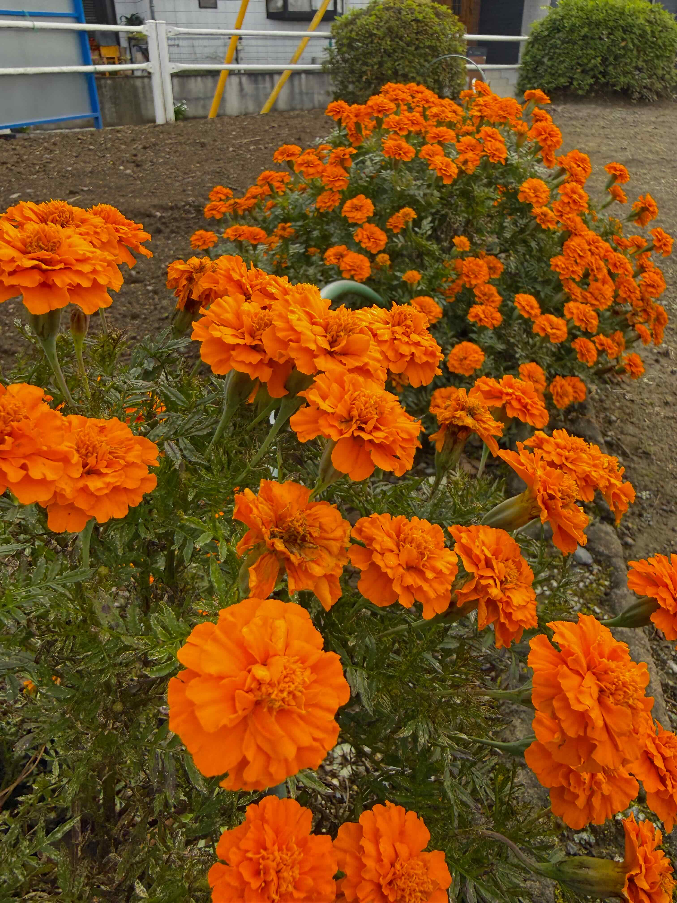
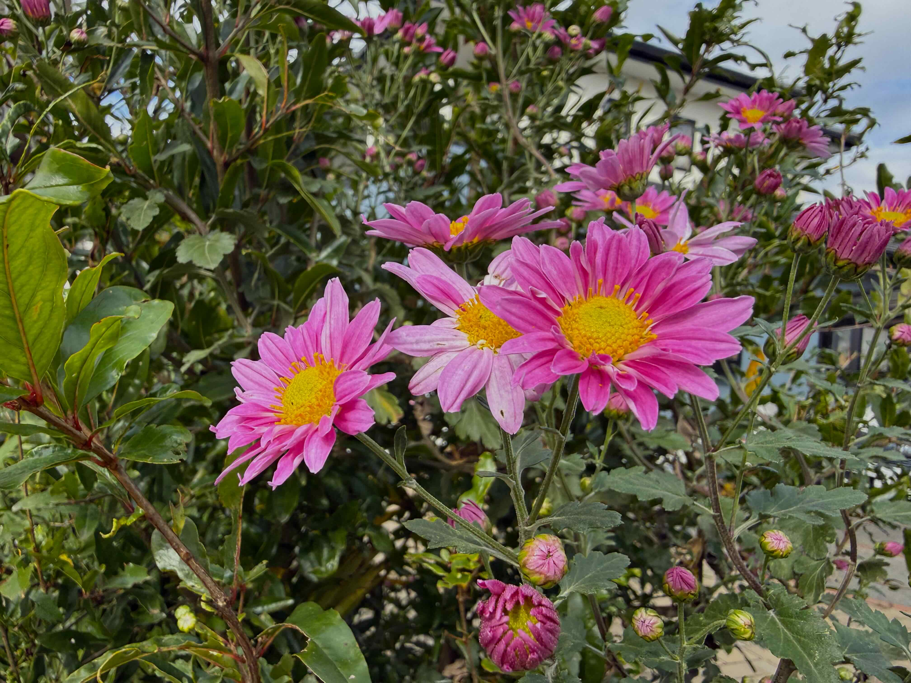
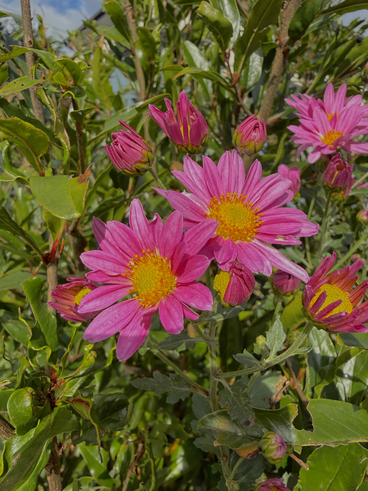
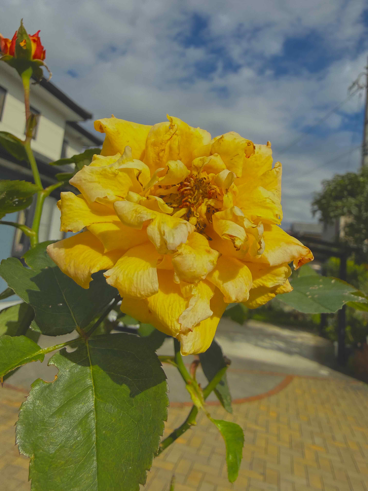
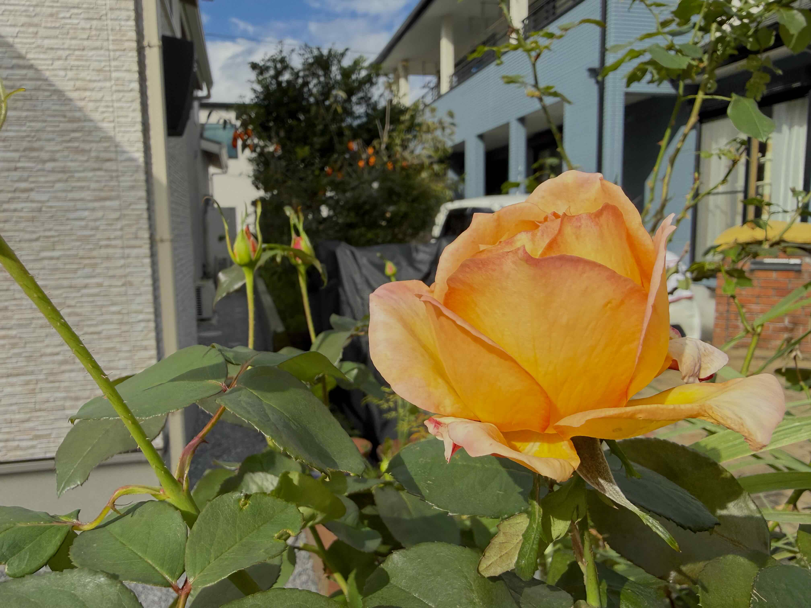
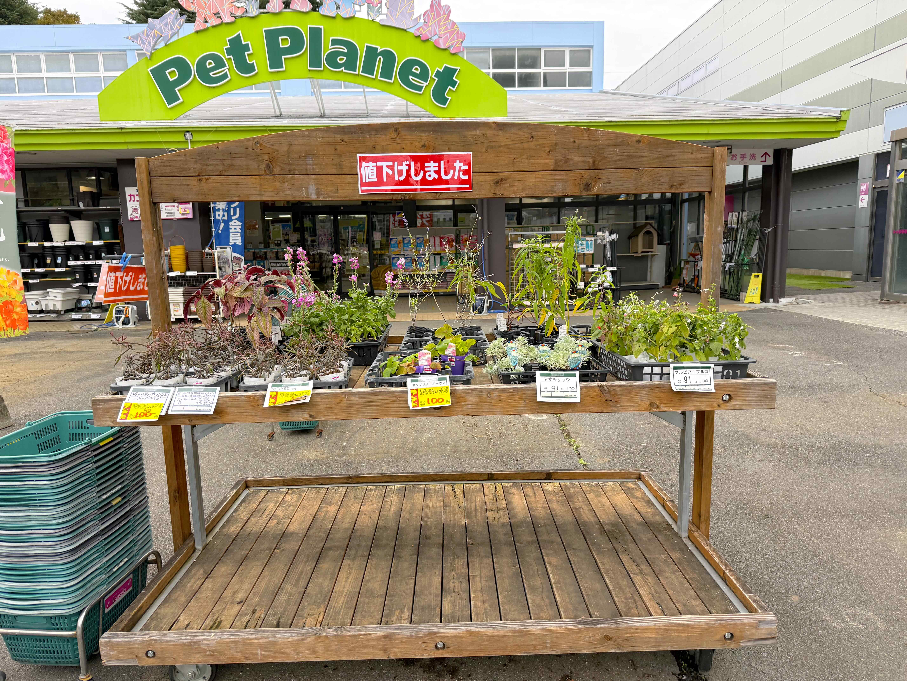

# 20261030_utsunomiya
<html lang="ja" data-loaded="false" data-scrolled="false" data-spmenu="closed">
<head>

<meta charset="UTF-8">
<meta http-equiv="Content-Type" content="text/html; charset=UTF-8">
<meta http-equiv="X-UA-Compatible" content="IE=EmulateIE10" />
<meta http-equiv="X-UA-Compatible" content="IE=edge">

<meta name="viewport" content="width=device-width, initial-scale=1.0">

<!--ここから上はお決まりの定型文です-->

<!--ここからが表現の書式などを決めるcssという部分-->

<link href="https://cdnjs.cloudflare.com/ajax/libs/lightbox2/2.7.1/css/lightbox.css" rel="stylesheet">

</head>

<body>

<!-- オープニング（スプラッシュ画面に写真とタイトルを配置） -->

  

    
    
最初の一枚は鮮やかなシクラメンのお花

  

<!-- メインコンテンツ -->

  <h1>メインのホームページ画像</h1>
  

<!--
    
<a href="https://peyng.github.io/restart/">前回までの記録</a>><a>今回2026,05,28</a>

-->

モバイル端末をお使いの場合は、画面を横向きにすると
背景画像の横方向がご覧頂けます。

<!--ここ上は、ほぼそのまま使います！-->

<!--QRコードの挿入例-->

 QR for Access

<marquee direction="left" scrollamount="20" width="30%">(^_^)/~alis</marquee>

<!--流れ文字の挿入例-->
<h1><marquee behavior="left">!!! 2026/10/30、公演とご近所のお花達から、ワンちゃん達とミスドのデザートまで !!!</marquee></h1>

<!--ここから下が、本体部分-->

<h2>2026Oct29、犬のお散歩で公演花壇のお花達とこんにちは</h2>

<h2>庭のお花達も元気に満開です</h2>

<h2>宇都宮駅東口のカンセキ、閉店セールもそろそろ終盤</h2>

<h2>ベルモールに移動してワンちゃん達とこんにちは</h2>

<h2>平日木曜で、メイン通路のベンチもガラガラ</h2>

<h2>CD屋さんにもお客さんが居ません</h2>

<h2>男子達がガチャガチャで盛り上がってました</h2>

<h2>いつものルートで本屋さん</h2>

<h2>こちらもお客さんが居ません</h2>

<h2>この棚は、ちょっと入れ替わりありました</h2>

<h2>お昼は軽くこれで済ませます</h2>

<h2>フードコート横のお花屋さんも綺麗です</h2>

<h2>デザートはミスドのエンゼルフレンチ</h2>

<!--
<h2>宇都宮市北部、カインズホーム経由吉野家までの走行経路はこのルート</h2>

-->

<h2>宇都宮LRTと抜きつ抜かれつしながらベルモール地下駐車場に出入りする運転動画</h2>

<iframe width="560" height="315" src="https://www.youtube.com/embed/DvpFP0wNhu8?si=LzMvmrtgdf5aQNLm&autoplay=1&mute=1&loop=1&playlist=DvpFP0wNhu8" title="YouTube video player" frameborder="0" allow="accelerometer; autoplay; clipboard-write; encrypted-media; gyroscope; picture-in-picture" allowfullscreen></iframe>
    

<!--
<h2>以上、今回も、お花達がメインでした</h2>

  
<h2>月齢の説明リンク貼ります</h2>
<h2><a href="https://starwalk.space/ja/moon-calendar" target="_blank">月齢カレンダー・リンク</a></h2>

  
  -->

<h2>今日のBGMは、Classic Country Music 🎧 The Best Timeless Hits of the 60s, 70s & 80s</h2>

<iframe width="560" height="315" src="https://www.youtube.com/embed/Jv02JMPJz7k?si=_WOAPO1MXWFm47-S" title="YouTube video player" frameborder="0" allow="accelerometer; autoplay; clipboard-write; encrypted-media; gyroscope; picture-in-picture; web-share" referrerpolicy="strict-origin-when-cross-origin" allowfullscreen></iframe>
    

   
<h2>2026Oct30、公演とご近所のお花達から、ワンちゃん達とミスドのデザートまででした Thank you for reading this far.</h2>

   

<!-- hitwebcounter Code START -->
<a href="https://www.hitwebcounter.com" target="_blank">

you are visitor The numbers are cumulative for the Bangkok ＆ Utsunomiya series websites launched since 2025 August 1st.
</a>  

<!--本体はここまで-->
    

<!--画面に空白地帯を作って、背景が見えるようにしています-->

    

<!-- フッタ -->
<footer>

Copyright 2026/10/30 alis

</footer>

<!--HPにさまざまなJavaScriptを呼び込むための書式-->

    </body>
    
</html>
